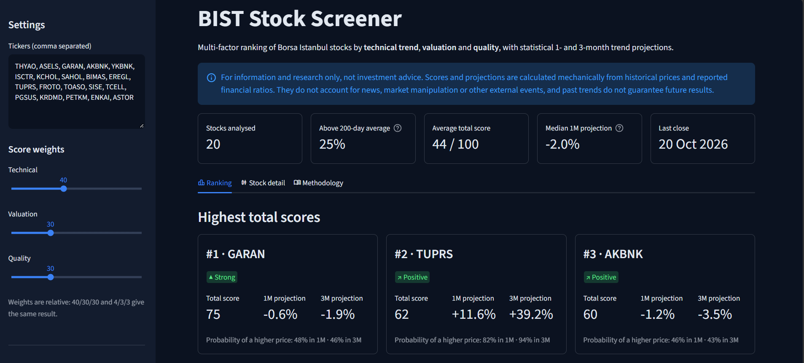

# BIST Stock Screener

A Streamlit web app that ranks Borsa Istanbul (BIST) stocks with a transparent,
multi-factor scoring model (**technical trend**, **valuation** and **quality**) and
adds statistical 1- and 3-month trend projections.



> **Disclaimer:** For information and research only, not investment advice. Scores and
> projections are calculated mechanically from historical prices and reported financial
> ratios. They do not account for news, market manipulation or other external events,
> and past trends do not guarantee future results.

## Features

- **Market overview:** number of stocks, market breadth (share above the 200-day average),
  average score, median 1-month projection
- **Ranking:** top-3 cards, score bar chart, score vs. projection scatter plot and a full
  ranked table with ratings (Strong → Very weak)
- **Stock detail:** price chart with 50/200-day averages and a 3-month projection cone,
  score breakdown, technical signal checklist, fundamentals
- **Methodology tab:** every formula explained inside the app
- Adjustable score weights, custom ticker list, CSV export

## How the scores work

| Score | Inputs | Logic |
|---|---|---|
| Technical | RSI-14, 50/200-day moving averages, 3-month return | Share of positive signals across short, medium and long horizons |
| Valuation | P/E, P/B | Percentile rank against the other stocks: cheaper is better. Loss-making companies get 0 on P/E |
| Quality | ROE, net margin, debt/equity | Percentile rank: higher profitability and lower debt is better |
| Total | The three scores | Weighted average. Missing data is skipped, not counted as zero |

**Rating:** 70+ Strong · 55-70 Positive · 45-55 Neutral · 30-45 Weak · below 30 Very weak

**Why percentile ranks instead of fixed thresholds?** With high inflation, a "cheap" P/E
level in Turkey moves over time. Comparing stocks with each other keeps the model
stable without re-tuning numbers.

## How the projections work

A scenario of "what happens if the last 6 months' trend and volatility continue":

1. Fit a straight line to the log of the last 126 daily prices; the slope is the daily trend.
2. Volatility = standard deviation of daily log returns over the same period.
3. Projection = trend × trading days (21 for 1 month, 63 for 3 months).
4. Likely range = projection ± volatility × √days (about 68% of outcomes).
5. P(up) = probability of a higher price, assuming normally distributed returns.

Trends often reverse, so this is a statistical scenario, not a forecast.

## Tech stack

Python · pandas · NumPy · Streamlit · Altair · yfinance · pytest

## Project structure

```
bist-stock-screener/
├── app.py              # Streamlit user interface (3 tabs)
├── data.py             # Yahoo Finance download (prices + fundamentals)
├── indicators.py       # SMA, RSI, returns
├── projection.py       # 1- and 3-month trend projections
├── scoring.py          # scores, ratings and the ranked table
├── tests/              # pytest unit tests (no internet needed)
├── .streamlit/         # app theme
└── requirements.txt
```

The calculation modules are kept separate from the data download and the user
interface, so they can be tested with small, fixed datasets.

## Run locally

```bash
python -m venv .venv
.venv\Scripts\activate          # macOS / Linux: source .venv/bin/activate
pip install -r requirements.txt
streamlit run app.py
```

## Run the tests

```bash
pytest
```

## Roadmap

- Backtest the total score and the projections against past returns
- Daily Telegram alerts for the top-ranked stocks (n8n workflow)
